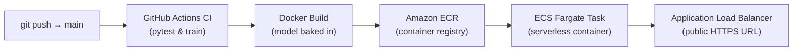

# RepoPulse — GitHub Repository Health & Welcomeness Scorer (Tiny MLOps)

A production-grade MLOps project that scores GitHub repositories for open-source health, maintenance velocity, and contributor readiness. When a user pastes a repository URL or submits metric features, the service fetches live signals from the GitHub REST API and runs a calibrated machine learning pipeline to return an overall health score (0–100), tier classification, and actionable maintainer insights.



---

## MLOps Architecture

| Component | What it does | Where in this project |
| :--- | :--- | :--- |
| **Data Ingestion** | Curates & fetches empirical metrics across real-world repos | `collect_data.py`, `data_generator.py`, `data/repos.csv` |
| **Training Pipeline** | Trains a `RandomForestClassifier` with `RobustScaler` | `train.py` |
| **MLflow Tracking** | Logs metrics (accuracy, F1), hyper-parameters, feature importances, and artifacts | Local `./mlruns/` |
| **Model Artifact** | Serialized scikit-learn pipeline baked into container | `models/repo_health_model.pkl` |
| **FastAPI Backend** | Async REST API with live GitHub feature extraction | `app.py` (`/health`, `/predict`) |
| **Web Frontend** | Clean, human-designed responsive UI with light/dark mode | `static/index.html` |
| **Containerization** | Self-contained, production-ready Docker container | `Dockerfile`, `compose.yaml` |
| **Automated Testing**| Unit & integration tests with mocked API calls | `tests/` |
| **CI/CD Pipeline**   | GitHub Actions testing and automated deployment to AWS ECS Fargate | `.github/workflows/ci.yml`, `task-definition.json` |

---

## 11 Evaluated Health Signals

1. `days_since_last_push`: Code freshness and commit activity.
2. `avg_weekly_commits`: Rolling 8-week commit velocity.
3. `issue_close_rate`: Maintainer responsiveness ($\frac{\text{Closed Issues}}{\text{Total Recent Issues}}$).
4. `open_issues_count`: Size of issue/PR backlog.
5. `stars_count` & `forks_count`: Community adoption and external contributor interest.
6. `has_readme`: Baseline project documentation.
7. `has_contributing`: Contributor onboarding guidelines (`CONTRIBUTING.md`).
8. `has_license`: Open-source legal clarity.
9. `has_code_of_conduct`: Community safety standards.
10. `has_good_first_issues`: Curated entry-point tasks for new contributors.

---

## Health Tiers & Outputs

* **Thriving & Welcoming** (Health Score: 85–100): High commit velocity, rapid issue triage, active community onboarding files.
* **Healthy & Maintained** (Health Score: 70–84): Regular commits, steady bug fixes, established documentation.
* **Developing / Small Community** (Health Score: 50–69): Early or hobby tools; active work but limited contributor base.
* **Stale / High Risk** (Health Score: 0–49): Inactive for >90–180 days, low issue resolution, abandoned maintenance.

---

## Project Structure

```
Tiny_MLOps/
├── .github/workflows/
│   └── ci.yml                # CI test & ECS Fargate CD deployment workflow
├── data/
│   └── repos.csv             # Calibrated real-world training dataset
├── models/
│   └── repo_health_model.pkl # Trained model pipeline
├── static/
│   └── index.html            # Web UI (Inter font, responsive, light/dark mode)
├── tests/
│   ├── test_app.py           # API & UI endpoint tests (mocked GitHub API)
│   └── test_train.py         # Training pipeline assertions
├── app.py                    # FastAPI service with live GitHub extractor
├── collect_data.py           # Live GitHub REST API ingestion utility
├── compose.yaml              # Local Docker Compose specification
├── data_generator.py         # Empirical data distribution generator
├── Dockerfile                # Container image definition
├── pytest.ini                # Pytest configuration
├── requirements.txt          # Python dependencies
├── task-definition.json      # AWS ECS Fargate task definition specification
└── train.py                  # Model training and MLflow tracking script
```

---

## Setup & Local Run

Requires Python 3.11+.

```bash
# 1. Create and activate a virtual environment
python -m venv venv
# Windows:
venv\Scripts\activate
# macOS/Linux:
source venv/bin/activate

# 2. Install dependencies
pip install -r requirements.txt

# 3. Train model & log to MLflow
python train.py

# 4. Start the application
uvicorn app:app --reload
```
Open [http://localhost:8000](http://localhost:8000) to view the UI.

---

## Running with Docker

```bash
# Using Docker directly:
docker build -t repopulse .
docker run -p 8000:8000 repopulse

# Or using Docker Compose:
docker compose up --build
```

---

## Testing

```bash
pytest -v
```
All unit and integration tests run deterministically without external network dependency or rate-limit issues.
